# Incident Report Final

**Simulasi Insiden Keamanan pada Replika Sistem Sprinkler Otomatis Berbasis Indeks Suhu-Kelembapan dan Visi Komputer untuk Mitigasi Stres Panas Sapi Perah**

Kelompok 5 - Skenario 05 Internal Database Fortress
TEK1314 Keamanan Siber - D4 Teknologi Rekayasa Komputer
IPB University, Semester 5, Tahun Akademik 2026-2027

Disusun mengikuti kerangka NIST Special Publication 800-61 Revision 2,
Computer Security Incident Handling Guide, dengan empat fase:
Preparation, Detection and Analysis, Containment Eradication and Recovery,
serta Post-Incident Activity.

Tanggal penyusunan: 25 November 2026

---

## 1. Ringkasan Eksekutif

### 1.1 Sistem yang dilindungi

Kelompok 5 menguji replika sistem sprinkler otomatis untuk mitigasi stres panas sapi perah berbasis mikrokontroler ESP32. Pada produk aslinya, sensor suhu dan kelembapan mengirim pembacaan ke Firebase Realtime Database, indeks suhu-kelembapan dihitung dari kedua nilai itu, kamera memantau perilaku ternak, dan peternak memantau kondisi lewat aplikasi. Ketergantungan pada layanan pihak ketiga membuat sistem itu sulit diperiksa secara internal, sehingga untuk keperluan pengujian dibangun replika yang seluruh komponennya berdiri sendiri di dalam satu jaringan terkendali.

Replika tersebut terdiri atas empat layanan yang berjalan pada satu host Linux: SSH untuk administrasi, dashboard web Flask pada port 3000 untuk menampilkan pembacaan sensor, broker MQTT Mosquitto pada port 1883 sebagai jalur masuk data dari perangkat, dan basis data MySQL pada port 3306 sebagai penyimpan. Pembacaan sensor masuk lewat MQTT, ditangkap oleh proses subscriber, lalu ditulis ke tabel `sensor_readings`, dan dashboard membacanya kembali untuk ditampilkan.

Lingkungan uji dibentuk dari tiga mesin virtual pada satu segmen layer 2 terisolasi bernama `pbl5-lan` dengan alamat 192.168.5.0/24. Target Node berada pada 192.168.5.5, Attacker Node pada 192.168.5.100, dan Monitoring Node yang menjalankan Security Onion pada 192.168.5.200. Seluruh data di dalam replika bersifat dummy. Pengujian tidak menyentuh jaringan kampus maupun sistem mitra.

### 1.2 Insiden yang disimulasikan

Insiden yang disimulasikan adalah pengambilalihan jalur data pada sistem sprinkler otomatis. Skenario ini dipilih karena memotret kegagalan yang paling sering terjadi pada proyek IoT mahasiswa: aplikasi dibangun dengan fokus pada fungsi, sementara asumsi keamanan diserahkan pada lingkungan yang dianggap tertutup.

Rangkaian serangan dijalankan dalam tiga skenario berurutan sesuai `attack_plan.md`. Skenario pertama adalah pengintaian seluruh 65535 port untuk memetakan layanan yang hidup. Skenario kedua adalah percobaan pengambilalihan kredensial pada basis data dan SSH. Skenario ketiga adalah eksploitasi pada dua permukaan yang tersisa, yaitu SQL injection pada endpoint dashboard dan penyisipan data palsu lewat broker MQTT tanpa autentikasi.

Dari ketiga skenario tersebut, hanya skenario ketiga yang berhasil menembus. Dua skenario pertama gagal bukan karena penyerang kurang berusaha, melainkan karena kontrol yang sudah dipasang pada Fase 1 bekerja sesuai rancangan. Ini temuan penting yang menentukan bentuk seluruh laporan: nilai proyek ini bukan pada banyaknya serangan yang berhasil, tetapi pada kemampuan membedakan antara kontrol yang memang sudah bekerja dan celah yang benar-benar belum tertutup.

### 1.3 Hasil akhir penanganan

Serangan SQL injection berhasil membaca seluruh isi tabel `sensor_readings` dan membocorkan struktur galat internal aplikasi. Serangan MQTT berhasil menyisipkan satu baris data palsu dengan identitas `sensor-99` dan nilai suhu 99.90 derajat, yang kemudian tampil di posisi teratas dashboard tanpa penanda apa pun bahwa data itu bukan berasal dari perangkat nyata. Inilah bentuk insidennya: bukan pencurian data masif, melainkan rusaknya kepercayaan pada data operasional.

Blue Team menutup kedua celah dengan dua perubahan pada tingkat aplikasi dan konfigurasi. Query basis data diubah menjadi parameterized query, keluaran diubah menjadi JSON terstruktur, dan mode debug dimatikan. Broker MQTT dikonfigurasi untuk mematikan akses anonim dan memasang berkas kata sandi. Pada proses ini ditemukan satu penyebab yang tidak terlihat dari dokumentasi mana pun: sebuah berkas konfigurasi lama dari bulan Oktober masih memuat `allow_anonymous true` dan dimuat paling akhir oleh Mosquitto, sehingga menimpa konfigurasi baru. Berkas itu belum dipindahkan sampai laporan ini disusun, sehingga autentikasi MQTT belum berlaku. Status ini dicatat terbuka pada Bagian 6, bukan dinyatakan selesai.

Verifikasi ulang dilakukan dengan payload yang identik. Permintaan normal tetap mengembalikan dua baris data `sensor-01` dalam bentuk JSON, sehingga terbukti aplikasi masih berfungsi dan bukan mati. Payload OR yang sebelumnya membuka seluruh tabel kini mengembalikan array kosong. Payload UNION yang sebelumnya menghasilkan galat 500 kini mengembalikan HTTP 200 dengan badan kosong, artinya aplikasi menolak masukan tanpa membocorkan jejak internal. Pada MQTT, klien anonim belum berhasil ditolak: pengujian terakhir masih menerima `CONNACK (0)`, dan perbaikannya dijadwalkan sebagai langkah tunggu yang dijelaskan pada Bagian 6 dan 7.

Satu hal perlu dinyatakan terbuka. Konfigurasi autentikasi MQTT sudah ditulis dengan benar, tetapi belum berlaku karena berkas lama menimpa. Kondisi ini bukan berarti broker sudah aman: klien anonim masih diterima sampai berkas lama dipindahkan. Perbaikannya satu langkah dan hasil yang harus dicapai sudah jelas, yaitu balasan kode 5 alih-alih kode 0. Laporan ini mencatatnya sebagai pekerjaan lanjutan, bukan sebagai keberhasilan.

### 1.4 Klasifikasi insiden

| Atribut | Nilai |
| --- | --- |
| Kategori | Unauthorized Access dan Data Integrity Violation |
| Dampak fungsional | Rendah sampai sedang. Layanan tetap berjalan, tetapi menampilkan data yang tidak berasal dari perangkat |
| Dampak informasi | Sedang. Seluruh isi tabel terbaca dan struktur galat internal terbocorkan |
| Kemampuan pulih | Tinggi. Perbaikan bersifat konfigurasi dan kode, tanpa kehilangan data permanen |
| Prioritas penanganan | Tinggi untuk integritas data, mengingat keputusan operasional bergantung pada angka yang ditampilkan |

Alasan penetapan dampak informasi pada tingkat sedang, bukan tinggi, adalah karena seluruh data di dalam replika bersifat dummy dan tidak mengandung identitas pribadi. Bila replika ini dipertemukan dengan data peternakan nyata, tingkatannya naik menjadi tinggi, dan itulah yang menjadi dasar seluruh rekomendasi pada Bagian 7.

---

## 2. Deklarasi Tech Stack dan Arsitektur

### 2.1 Topologi dan rencana alamat

Topologi yang dipakai adalah star topology dalam satu segmen LAN terisolasi. Ketiga node berada pada satu segmen layer 2 tanpa router, sehingga tidak ada gateway dan seluruh alamat bersifat statis. Pada implementasi VirtualBox, segmen tersebut dibentuk oleh jaringan internal `pbl5-lan`. Switch 2960 yang tampak pada diagram hanya representasi visual dan tidak memiliki alamat IP.

| No | Hostname | Peran | Alamat | Sistem Operasi |
| --- | --- | --- | --- | --- |
| 1 | Target-Node-K05 | Target Node | 192.168.5.5 | Ubuntu Server 26.04 LTS, kernel 7.0.0-38-generic |
| 2 | Attacker-Node-K05 | Attacker Node | 192.168.5.100 | Cybersecurity LabVM, Ubuntu 22.04 |
| 3 | Monitoring-Node-K05 | Monitoring Node | 192.168.5.200 | CyberOps Security Onion |

Pemilihan alamat mengikuti blok yang disepakati pada `ip_plan.md`, dengan infrastruktur pada rentang 1 sampai 9, server target pada 10 sampai 49, dan perangkat penyerang pada 100 sampai 199. Penetapan statis dipilih agar alamat tidak berubah di tengah pengujian, karena setiap berkas bukti merujuk alamat secara eksplisit.

Satu kendala nyata muncul pada implementasi. Alamat 192.168.5.100 pada Attacker Node hilang setiap kali mesin dinyalakan ulang, karena berkas netplan ditulis ulang saat boot dan aturan `match: name: en*` tidak lagi cocok dengan nama antarmuka setelah pembaruan kernel. Penyelesaian sementara dilakukan dengan menambahkan alamat secara manual setiap sesi. Kendala ini dicatat karena memengaruhi keandalan pengujian berulang, dan solusi permanennya masuk daftar rekomendasi.

### 2.2 Pemetaan tech stack asli ke replika

Bagian ini menjelaskan mengapa replika dibangun dengan komponen yang berbeda dari produk aslinya, dan sejauh mana perbedaan itu masih mewakili perilaku sistem yang sebenarnya.

| Komponen produk asli | Padanan pada replika | Alasan penggantian | Kesetaraan perilaku |
| --- | --- | --- | --- |
| ESP32 dengan sensor suhu dan kelembapan | Publisher MQTT dari mesin penyerang dan skrip uji | Tidak ada perangkat fisik pada lingkungan uji | Setara pada sisi protokol. Perangkat nyata mengirim ke topik, replika juga |
| Firebase Realtime Database | Broker Mosquitto dan MySQL | Firebase adalah layanan terkelola yang tidak bisa diperiksa konfigurasinya | Setara pada pola, tidak setara pada implementasi. Firebase tidak memiliki konsep port terbuka atau berkas kata sandi |
| Aplikasi pemantauan peternak | Dashboard Flask pada port 3000 | Antarmuka asli berbasis klien, sedangkan replika memakai web server sendiri agar jalur query bisa diperiksa | Setara pada fungsi tampilan, berbeda pada teknologi |
| Autentikasi akun Firebase | Akun `app_iot` pada MySQL dan akun sistem `fattih` | Tidak ada penyedia identitas pada replika | Sebagian. Replika menguji hak akses basis data, bukan alur login pengguna akhir |
| Log layanan terkelola | rsyslog yang meneruskan ke Security Onion | Layanan terkelola menyediakan log sendiri, replika harus membangun jalurnya | Setara pada tujuan, berbeda pada kelengkapan |

Perbedaan yang paling perlu disadari adalah pada Firebase. Layanan itu menangani autentikasi, aturan akses, dan validasi di sisi server, sehingga sebagian besar kelas kerentanan yang diuji di replika tidak muncul dengan bentuk yang sama pada produk asli. Karena itu, temuan pada replika tidak boleh dibaca sebagai daftar celah produk mitra. Yang diuji adalah pola pikir dan prosedur, yaitu bagaimana sebuah tim mendeteksi, menganalisis, dan menutup celah pada sistem yang menyerupai bentuk umum arsitektur IoT.

### 2.3 Permukaan serangan yang teridentifikasi

Dari hasil pengintaian, permukaan serangan yang benar-benar terbuka pada kondisi saat serangan dijalankan hanya tiga: SSH pada 22, broker MQTT pada 1883, dan dashboard pada 3000. MySQL pada 3306 tidak terlihat dari jaringan karena sudah dibatasi ke loopback. Port 80 tertutup karena Apache dimatikan. Dari 65535 port yang dipindai, 65532 di antaranya tidak menjawab sama sekali.

Angka ini penting untuk membaca seluruh laporan, dan ada satu perbedaan yang perlu dijelaskan agar tidak disalahartikan. Pemindaian setelah hardening pada 19 Oktober menemukan dua port terbuka, yaitu 1883 dan 3000, dengan 65533 port tersaring. Port 22 tidak muncul pada pemindaian itu, meskipun pada pemindaian deteksi versi pada hari yang sama port 22 tercatat terbuka. Pemindaian red team pada 24 November menemukan tiga port terbuka, yaitu 22, 1883, dan 3000, dengan 65532 port tersaring.

Perbedaan ini berasal dari kondisi pemindaian, bukan dari perubahan konfigurasi di antaranya. Angka yang dipakai sebagai dasar analisis pada laporan ini adalah hasil pemindaian 24 November, karena itulah yang dijalankan pada kondisi saat serangan berlangsung. Penyebutan angka 19 Oktober disertakan agar pembaca yang membuka berkas bukti tidak menemukan pertentangan yang tidak dijelaskan.

Sebelum hardening, pemindaian menemukan lima port terbuka, yaitu 22, 80, 1883, 3000, dan 3306, dengan 65530 port tertutup. Penurunan dari lima menjadi tiga bukan hasil mitigasi insiden, melainkan hasil pekerjaan Fase 1 yang sudah dilakukan sebelum serangan dijalankan.

---

## 3. Preparation

### 3.1 Prinsip yang dipakai

Pekerjaan persiapan berangkat dari satu keputusan metodologis: serangan harus diukur terhadap kondisi sistem yang sudah diperketat, bukan terhadap mesin mentah. Alasannya praktis. Bila pengukuran dilakukan pada mesin mentah, seluruh serangan akan berhasil dan tim hanya akan menghasilkan daftar panjang celah yang sudah diketahui sejak awal. Dengan mengukur pada kondisi yang sudah diperketat, hasilnya menjadi informatif: yang gagal menunjukkan kontrol mana yang bekerja, dan yang tembus menunjukkan prioritas perbaikan yang sebenarnya.

Keputusan kedua adalah mewajibkan bukti before dan after untuk setiap kontrol, bukan klaim. Setiap kontrol pada checklist harus punya tangkapan layar keadaan sebelum, tangkapan layar keadaan sesudah, dan perintah verifikasi yang bisa diulang orang lain. Aturan ini yang kemudian membuat analisis pada Bagian 4 bisa dipertanggungjawabkan, karena setiap pernyataan tentang kontrol yang bekerja punya rujukan berkas.

### 3.2 Hardening baseline kategori A: akses dan autentikasi

Kategori ini menutup jalur masuk yang paling sering dipakai penyerang, yaitu kredensial lemah pada layanan administrasi.

Kontrol A1 mengubah SSH agar hanya menerima kunci publik. Nilai `passwordauthentication` diset menjadi no, `permitrootlogin` menjadi no, `maxauthtries` menjadi 3, dan hanya akun `fattih` yang diizinkan masuk. Konsekuensinya besar: seluruh percobaan brute force kata sandi menjadi mustahil bukan karena kata sandinya kuat, melainkan karena mekanisme yang dipakai brute force sudah tidak ada. Ini perbedaan yang harus dinyatakan dengan tepat, karena banyak laporan menyebut "kata sandi berhasil dipertahankan" padahal yang terjadi adalah "jalur kata sandi sudah ditutup".

Kontrol A2 merapikan akun dan hak sudo. Izin direktori home diperketat menjadi 700, berkas sudoers khusus dipasang dengan izin 440, dan akun root dikunci. Tujuannya mempersempit ruang gerak setelah seseorang berhasil masuk, sehingga satu kredensial yang bocor tidak otomatis berarti kendali penuh atas sistem.

Kontrol A3 mengaktifkan fail2ban pada jail sshd dengan `maxretry 3`, `findtime 600`, dan `bantime 1800`. Kontrol ini bukan pencegahan, melainkan pembatasan laju. Nilainya terlihat pada Bagian 4, ketika alamat penyerang benar-benar masuk daftar blokir selama pengujian berlangsung.

### 3.3 Hardening baseline kategori B: layanan dan permukaan serangan

Kontrol B1 mematikan layanan yang tidak dipakai. Apache dan layanan bawaan dimatikan sampai port 80 tidak lagi mendengar. Yang tersisa hanya layanan yang benar-benar dibutuhkan replika.

Kontrol B2 memasang firewall ufw dengan kebijakan bawaan menolak seluruh lalu lintas masuk, lalu membuka hanya port yang dipakai, yaitu 22, 1883, dan 3000, dan hanya dari jaringan lab 192.168.5.0/24. Port 3306 sengaja tidak dibuka.

Kontrol B3 memperbarui sistem. Kernel berada pada 7.0.0-38-generic, dan jumlah paket yang menunggu pembaruan turun dari 26 menjadi 0 setelah full-upgrade dan autoremove. Ini kontrol yang paling sering dilewatkan karena hasilnya tidak terlihat pada tangkapan layar, padahal dampaknya besar: sebagian besar kerentanan yang dieksploitasi di dunia nyata adalah kerentanan yang sudah punya tambalan.

### 3.4 Hardening baseline kategori C: data dan aplikasi

Kontrol C1 membatasi MySQL agar hanya mendengarkan di 127.0.0.1 pada port 3306 dan 33060. Setelah kontrol ini aktif, percobaan koneksi dari mesin penyerang tidak dijawab sama sekali, dan paket tidak pernah sampai ke layanan. Kegagalannya berbentuk timeout, bukan penolakan, karena paket dijatuhkan di depan layanan. Inilah yang kemudian membuat seluruh Skenario 2 berakhir tanpa satu pun kredensial teruji.

Kontrol C2 merapikan akun basis data. Akun `webapp` yang memegang ALL PRIVILEGES beserta WITH GRANT OPTION dihapus. Yang tersisa adalah `app_iot` dengan hak SELECT, INSERT, dan UPDATE pada `iot_db` saja. Percobaan masuk ke basis data sistem dijawab ERROR 1044. Pada pengujian ditemukan bahwa akun ini juga tidak punya hak DELETE, yang terbukti dari ERROR 1142 saat percobaan pembersihan data palsu dilakukan. Detail ini menjadi penting pada Bagian 5.

Kontrol C3 mengeluarkan kredensial dari kode aplikasi. Berkas `app.py` versi kedua hanya merujuk variabel, sedangkan nilai sebenarnya berada di `/etc/iot/iot.env` dengan izin -rw------- milik root. Percobaan membaca berkas itu oleh pengguna biasa ditolak. Kontrol ini menutup kebiasaan menyimpan kata sandi di dalam kode, yang berbahaya karena kode mudah tersalin ke tempat lain sementara berkas konfigurasi bisa dijaga izinnya.

Kontrol C4 mengirim log ke Security Onion. Berkas `/etc/rsyslog.d/50-pbl5-forward.conf` berisi penerusan ke 192.168.5.200 port 514, sambungan berstatus ESTABLISHED dari 192.168.5.5 port 36168, dan aturan izin di sisi Security Onion sudah dipasang. Tanpa kontrol ini, seluruh analisis pada Bagian 4 tidak akan punya bahan.

### 3.5 Dua kontrol yang sengaja ditunda

Dari sepuluh kontrol, ada dua yang sengaja belum dikerjakan dan dijadwalkan menjadi bahan mitigasi setelah serangan dijalankan: autentikasi broker MQTT dan validasi masukan pada endpoint dashboard. Penundaan ini bukan kelalaian, melainkan bagian dari rancangan siklus. Bila keduanya ditutup sebelum serangan, skenario ketiga tidak akan punya apa pun untuk diuji, dan Tahap 4 serta Tahap 5 pada purple team log akan kosong.

Keputusan ini punya konsekuensi yang harus diterima: sistem sengaja dibiarkan punya dua celah nyata selama Fase 2 berlangsung. Karena seluruh pengujian berjalan di segmen terisolasi tanpa koneksi ke jaringan luar, risiko yang timbul terbatas pada lab itu sendiri.

### 3.6 Aturan keterlibatan

Seluruh pengujian mengikuti `rules-of-engagement.md`. Batasannya jelas: sasaran hanya Target Node replika pada 192.168.5.5, dilarang menyentuh sistem produksi mitra, dan seluruh data yang dipakai bersifat dummy. Pengujian dijalankan pada segmen `pbl5-lan` yang terisolasi, sehingga tidak ada risiko kebocoran ke jaringan kampus.

Satu catatan yang perlu disampaikan secara terbuka. Perangkat host Windows yang dipakai menyusun dokumen ini bukan bagian dari aset skenario, sehingga tidak pernah masuk sebagai sasaran maupun temuan. Bila ada kerentanan pada host tersebut, hal itu di luar cakupan laporan ini.
# Bagian 4 dan 5

## 4. Detection and Analysis

### 4.1 Cara kerja deteksi pada lingkungan ini

Seluruh pengamatan dilakukan dari Monitoring Node yang menjalankan Security Onion pada 192.168.5.200. Log dari Target Node diteruskan lewat rsyslog ke port 514, sedangkan lalu lintas jaringan ditangkap dengan tcpdump dan diimpor ke sensor. Antarmuka analisis yang dipakai adalah Kibana pada indeks logstash.

Satu karakteristik sensor perlu dinyatakan di depan, karena memengaruhi seluruh pembacaan pada bagian ini. Sensor pada lab berjalan dalam mode import, dengan nama `seconion-import`, bukan sensor yang memantau antarmuka jaringan secara langsung. Artinya, yang dilihat sistem deteksi adalah berkas tangkapan yang diimpor, bukan arus lalu lintas yang mengalir saat serangan berlangsung. Konsekuensinya: deteksi punya jeda, dan kelengkapan bukti bergantung pada benar tidaknya berkas tangkapan diambil.

Keterbatasan ini bukan alasan untuk mengabaikan hasil deteksi. Yang tercatat tetap nyata, dan yang tidak tercatat tetap harus dijelaskan. Justru di sinilah analisis menjadi bernilai, karena tugas analis bukan melaporkan apa yang muncul di layar, melainkan menjelaskan mengapa sesuatu muncul dan mengapa yang lain tidak.

### 4.2 Skenario 1: Pengintaian

**Apa yang dilakukan penyerang.** Pemindaian seluruh 65535 port pada 192.168.5.5 dari 192.168.5.100, dilanjutkan deteksi versi layanan dan sidik sistem operasi. Penangkapan lalu lintas dijalankan bersamaan untuk mendapatkan bahan analisis.

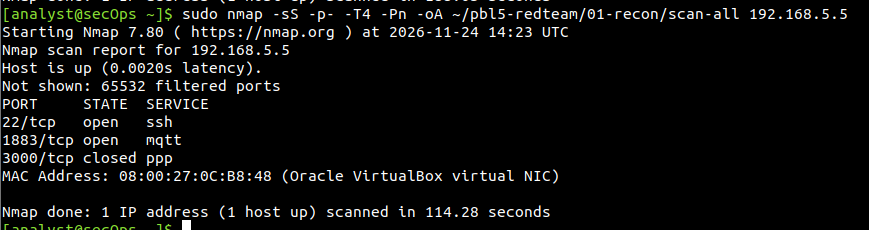

**Apa yang terlihat.** Pemindaian menemukan tiga port terbuka, yaitu 22 SSH, 1883 MQTT, dan 3000 dashboard. Sebanyak 65532 port tidak menjawab dan dilaporkan sebagai tersaring, yang menandakan firewall menolak dengan cara menjatuhkan paket, bukan menolak dengan balasan. Deteksi versi pada daftar port terpilih menunjukkan port 80 filtered, 3306 filtered, dan 9090 filtered, yang mengonfirmasi bahwa layanan di luar daftar izin memang tidak terjangkau.

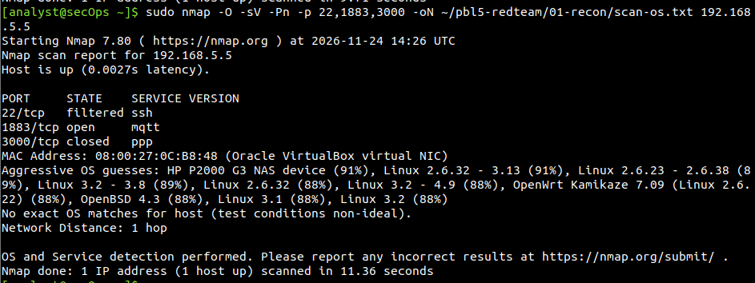

Deteksi versi menunjukkan OpenSSH 10.2p1. Sidik sistem operasi tidak menghasilkan kecocokan, dengan tebakan tertinggi hanya 91 persen dan mengarah ke perangkat penyimpanan jaringan, bukan ke Ubuntu Server. Ini bukan kegagalan alat, melainkan akibat langsung dari kontrol B1 dan B2: karena hampir semua port tidak menjawab, sistem operasi tidak punya cukup jejak untuk dikenali.

**Bagaimana insiden terdeteksi.** Berkas tangkapan berisi 300 paket dalam ukuran 33 kilobyte diimpor ke sensor. Kibana menampilkan 50 hits, dengan alert `GPL ICMP_INFO PING` berkategori misc-activity, sumber 192.168.5.106 menuju 192.168.5.5.

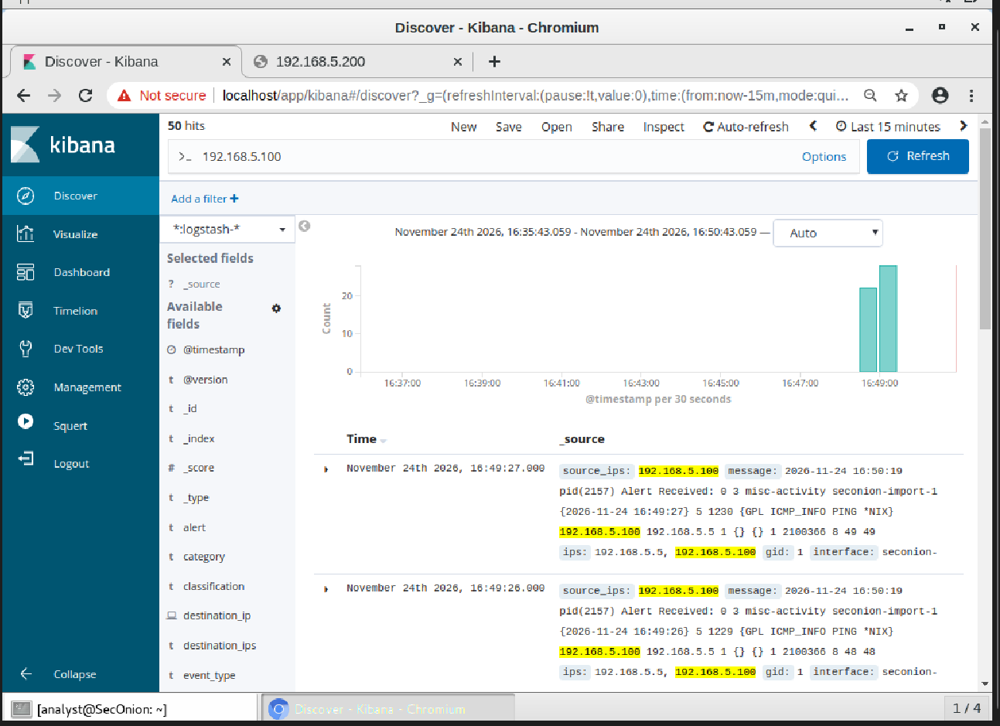

**Mengapa hanya ICMP yang muncul.** Ini bagian yang paling penting untuk dijelaskan dengan jujur, karena mudah disalahartikan sebagai kegagalan sistem deteksi. Pemindaian SYN terhadap 65533 port yang dijatuhkan firewall tidak menghasilkan signature yang cocok, sebab sensor berbasis signature mengenali pola pada percobaan koneksi yang mendapat balasan, bukan pada paket yang dibuang tanpa jawaban. Yang tersisa dan dikenali hanyalah lalu lintas ICMP dari pemeriksaan konektivitas sebelumnya.

Kesimpulannya: pengintaian **terdeteksi sebagian**, dan yang terdeteksi bukan inti serangannya. Seorang analis yang hanya membaca alert akan menyimpulkan tidak ada yang terjadi, padahal pemindaian penuh sedang berlangsung.

**Klasifikasi insiden.**

| Atribut | Nilai | Alasan |
| --- | --- | --- |
| Kategori | Reconnaissance | Belum ada upaya akses, hanya pemetaan |
| Dampak fungsional | Tidak ada | Layanan tidak terganggu, tidak ada penurunan kinerja |
| Dampak informasi | Rendah | Yang terbocorkan hanya keberadaan dan versi layanan publik |
| Prioritas | Rendah | Tidak memerlukan tindakan darurat, tetapi memerlukan pencatatan |

Meskipun prioritasnya rendah, pengintaian ini tetap dicatat sebagai insiden karena menjadi dasar dua skenario berikutnya. Tanpa peta port, penyerang tidak akan tahu ke mana harus menembak.

**Analisis akar masalah.** Penyebab pengintaian berhasil bukan pada kelalaian konfigurasi, karena port yang terbuka memang port yang dibutuhkan sistem. Penyebabnya ada pada ketiadaan mekanisme pembatasan laju koneksi dan ketiadaan deteksi berbasis perilaku. Firewall menolak dengan cara menjatuhkan paket, yang secara teknis baik, tetapi juga berarti penyerang bisa memindai dalam waktu lama tanpa mendapat sinyal bahwa dirinya diamati.

### 4.3 Skenario 2: Percobaan pengambilalihan kredensial

**Apa yang dilakukan penyerang.** Dua jalur dicoba bersamaan. Pada basis data, enumerasi dengan skrip NSE `mysql-info` dan `mysql-enum` dilanjutkan uji koneksi langsung dan percobaan 20 kandidat kata sandi dengan Hydra. Pada SSH, percobaan serupa dijalankan dengan daftar kata sandi.

**Apa yang terlihat pada basis data.** Enumerasi NSE berakhir tanpa hasil karena port dilaporkan filtered dan tidak ada skrip yang berjalan. Uji koneksi langsung berakhir timeout.

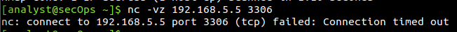

Hydra mencoba 20 kandidat dan melaporkan 0 valid password. Yang penting dibaca di sini bukan angka nolnya, melainkan pesan galatnya: Hydra tidak pernah berhasil membentuk koneksi ke basis data, sehingga tidak ada satu pun kata sandi yang benar-benar diuji.

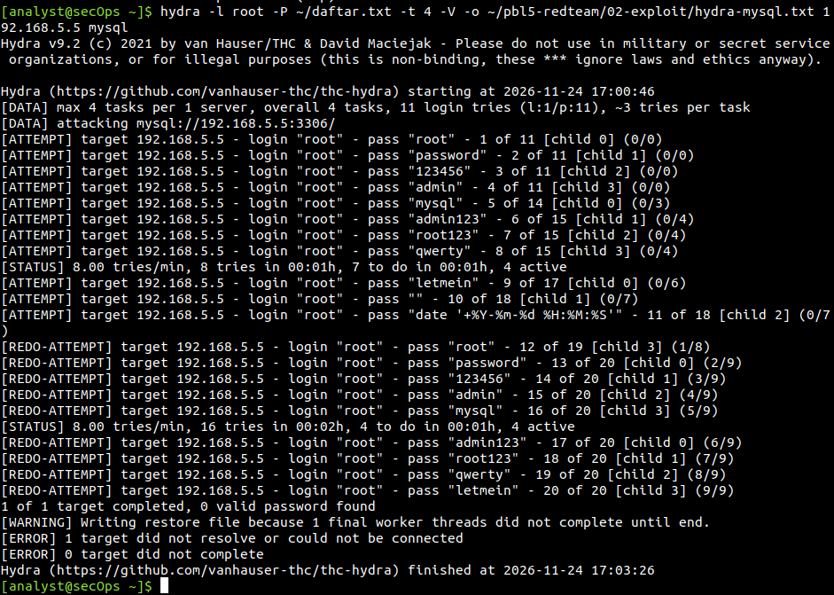

**Apa yang terlihat pada SSH.** Hydra ditolak sebelum mencoba, dengan balasan method reply 4 yang menandakan server hanya menawarkan metode kunci publik. Tidak ada negosiasi kata sandi yang berlangsung.

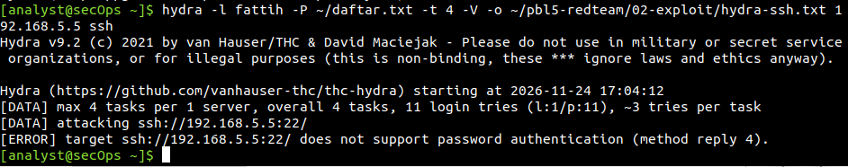

Konfigurasi efektif yang dibaca langsung dari server menunjukkan `pubkeyauthentication yes` dan `passwordauthentication no`.

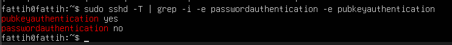

**Bagaimana insiden terdeteksi.** Di sini deteksinya justru berhasil dan hasilnya jelas. fail2ban pada jail sshd mencatat lima kegagalan, lalu memblokir 192.168.5.100 selama 1800 detik. Blokir terjadi dua kali, pada pukul 13.50.22 dan 14.26.26, dengan satu pembukaan blokir di antaranya.

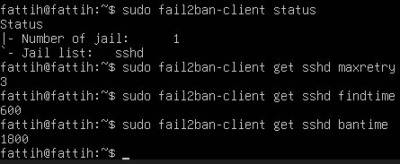

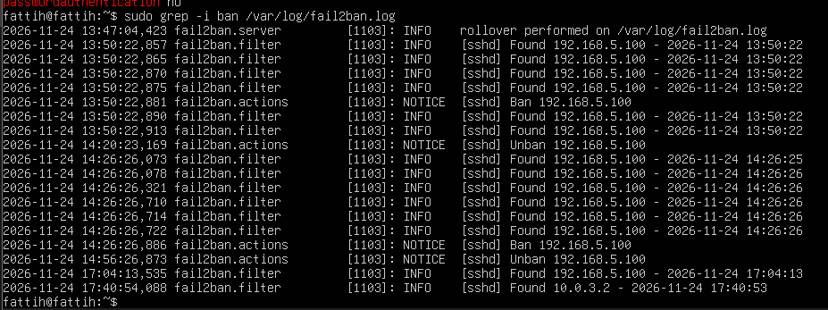

Ada satu hal yang harus dijelaskan agar dua bukti ini tidak tampak bertentangan. Blokir terjadi pada pukul 13.50 dan 14.26, sedangkan pengujian Hydra pada SSH dijalankan pukul 16.56 sampai 17.10. Urutannya: percobaan login lebih dulu dilakukan pada sesi pagi, fail2ban memblokir, lalu pada sesi sore percobaan diulang setelah blokir berakhir, dan server menolak pada tahap negosiasi metode. Dua peristiwa ini berbeda, bukan saling membantah.

**Klasifikasi insiden.**

| Atribut | Nilai | Alasan |
| --- | --- | --- |
| Kategori | Attempted Unauthorized Access | Upaya akses tanpa keberhasilan |
| Dampak fungsional | Tidak ada | Layanan tetap melayani pengguna sah |
| Dampak informasi | Tidak ada | Tidak ada data yang terbaca atau terbocorkan |
| Prioritas | Rendah | Ditangani otomatis oleh kontrol yang sudah aktif |

**Analisis akar masalah.** Tidak ada akar masalah pada sistem, karena jalur ini memang sudah tertutup sejak Fase 1. Yang ada adalah dua kontrol yang bekerja dengan mekanisme berbeda. Pada MySQL, kontrol C1 membuat paket tidak pernah sampai ke layanan, sehingga kegagalan berbentuk timeout, bukan penolakan. Pada SSH, kontrol A1 membuat layanan tetap menjawab tetapi menolak metode yang dipakai brute force, sehingga kegagalan berbentuk penolakan pada tahap negosiasi.

Perbedaan bentuk kegagalan ini penting untuk tidak salah dibaca. Timeout pada MySQL bukan berarti layanan rusak, dan penolakan pada SSH bukan berarti kata sandi kuat. Keduanya terjadi karena jalur serangannya sudah tidak ada, bukan karena pertahanan di ujung jalur berhasil.

Satu hal yang perlu dicatat sebagai kekurangan: fail2ban berfungsi, tetapi bekerja pada lapisan yang sudah tidak lagi menjadi jalur masuk. Nilai praktisnya rendah pada konfigurasi sekarang, karena autentikasi kata sandi sudah dimatikan lebih dulu. Kontrol ini tetap dipertahankan sebagai lapisan kedua, untuk keadaan ketika konfigurasi SSH suatu saat dilonggarkan.

### 4.4 Skenario 3: Eksploitasi web dan protokol IoT

Skenario inilah yang menghasilkan insiden nyata, dan karena itu analisisnya paling panjang.

**Apa yang dilakukan penyerang.** Dua jalur. Pertama, SQL injection pada endpoint `/sensor` di dashboard port 3000, dengan empat varian payload: normal, OR, AND, dan UNION. Kedua, penyadapan dan penyisipan pada broker MQTT port 1883, dengan berlangganan ke topik `sensors/#` lalu mengirim pesan ke topik yang dipakai subscriber.

#### 4.4.1 Keadaan normal sebagai pembanding

Langkah pertama bukan menyerang, melainkan menetapkan garis dasar. Permintaan normal ke `sensor-01` mengembalikan dua baris data dalam format repr tuple Python, lengkap dengan semua kolom tanpa struktur.

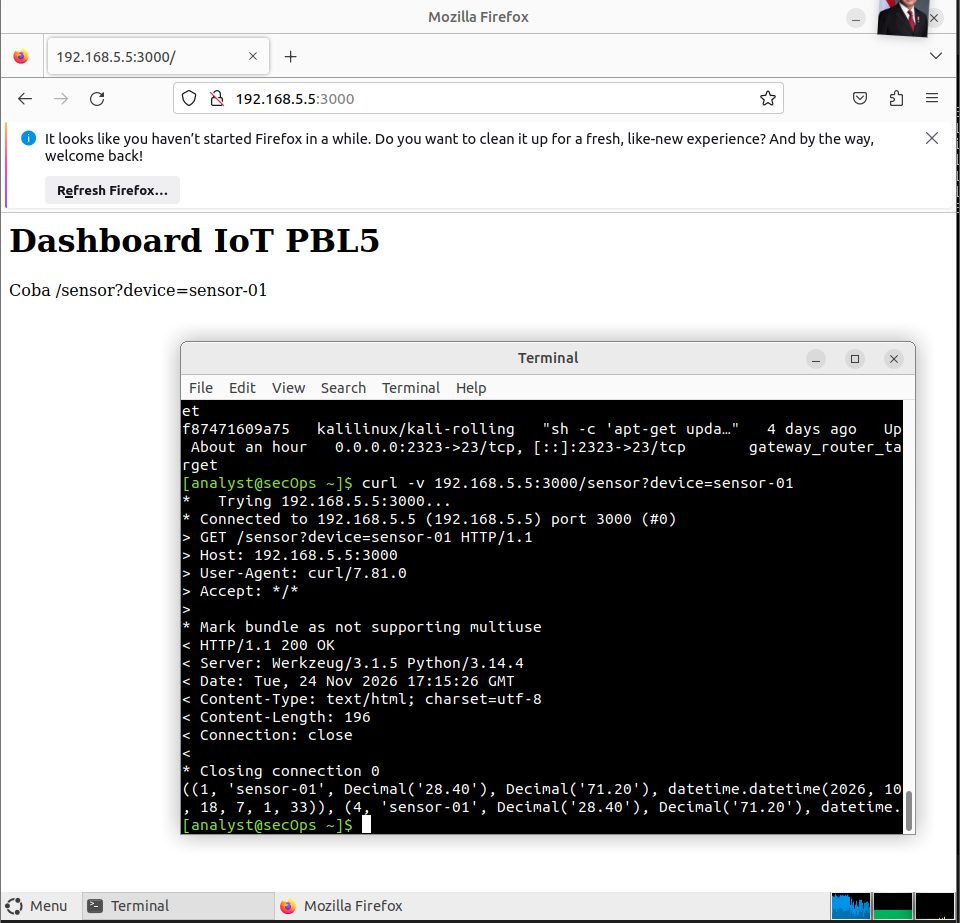

Bentuk keluaran ini sendiri sudah merupakan temuan. Aplikasi membocorkan struktur internal basis data ke klien, termasuk urutan kolom dan tipe data. Ini bukan kerentanan yang bisa dieksploitasi langsung, tetapi merupakan kebocoran informasi yang memudahkan penyusunan payload berikutnya.

#### 4.4.2 SQL injection berbasis OR

Payload `x' OR '1'='1` mengubah klausa WHERE menjadi selalu benar. Hasilnya bukan dua baris, melainkan empat baris, yaitu seluruh isi tabel.

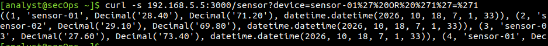

Perubahan dari dua baris menjadi empat baris inilah bukti definitif bahwa masukan pengguna memengaruhi logika query. Bukan dugaan, bukan indikasi, melainkan perbedaan hasil yang terukur dan bisa diulang.

#### 4.4.3 SQL injection berbasis AND dan UNION

Payload `x' AND '1'='2` menghasilkan nol baris, yang mengonfirmasi bahwa klausa tambahan benar-benar dieksekusi. Payload UNION dengan empat kolom menghasilkan galat 500.

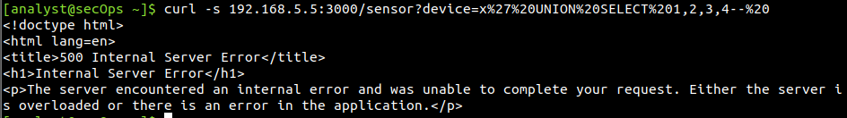

Galat 500 ini penting karena dua alasan. Pertama, membuktikan jumlah kolom pada query asli bukan empat, sehingga penyerang perlu menebak ulang. Kedua, lebih serius: halaman galat membocorkan jejak tumpukan internal aplikasi. Dalam konfigurasi production, galat seperti ini tidak boleh sampai ke klien.

#### 4.4.4 Penyadapan dan penyisipan MQTT

Broker menerima langganan tanpa identitas. Balasan `CONNACK (0)` menandakan koneksi diterima tanpa autentikasi, dan langganan ke `sensors/#` berhasil.

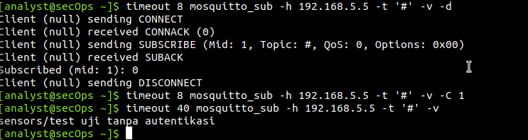

Dengan jalur baca terbuka, jalur tulis juga terbuka. Pesan dikirim ke topik yang dipantau subscriber, dan diterima tanpa pemeriksaan asal.

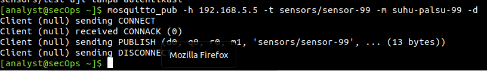

Subscriber menerima pesan itu dan menuliskannya ke basis data dengan identitas dari nama topik. Log subscriber mencatat `tersimpan: sensor-99 99.9 0.0`.

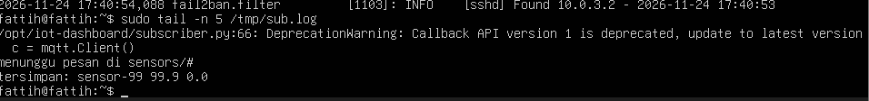

Hasilnya bisa dilihat pada tabel. Baris dengan id 8, identitas `sensor-99`, suhu 99.90, dan kelembapan 0.0 masuk ke basis data.

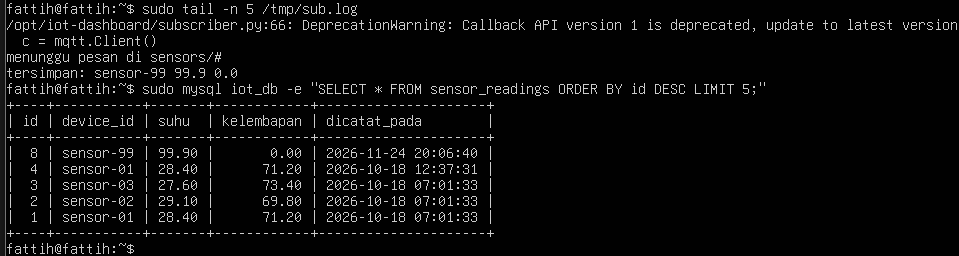

Dan yang paling penting, dashboard menampilkannya di posisi teratas tanpa penanda apa pun bahwa data itu bukan berasal dari perangkat nyata.

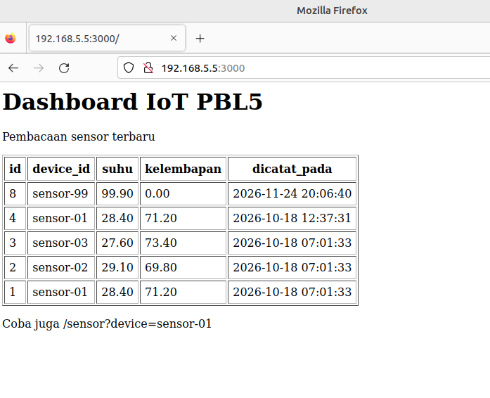

Di titik ini insidennya menjadi nyata. Bukan karena data dicuri, melainkan karena data operasional tidak lagi bisa dipercaya. Peternak yang membaca dashboard akan menyimpulkan suhu 99.90 derajat, dan mengambil keputusan berdasarkan angka yang dibuat orang lain.

Ada satu detail yang perlu dicatat untuk ketepatan analisis. Baris palsu sempat muncul tiga kali, dan penyebabnya bukan tiga kali pengiriman, melainkan tiga proses subscriber yang berjalan bersamaan. Setiap proses menulis pesan yang sama secara mandiri. Ini bukan bagian dari serangan, melainkan kesalahan operasional pada saat pengujian, dan sengaja dicatat agar jumlah baris tidak disalahartikan sebagai jumlah serangan.

#### 4.4.5 Bagaimana insiden terdeteksi

Deteksi pada skenario ini paling lemah, dan itu harus dinyatakan apa adanya. Kibana menampilkan lalu lintas penyerang menuju target, tetapi yang tercatat adalah alert ICMP dan aktivitas umum. Tidak ada signature yang mengenali payload SQL injection pada parameter URL, dan tidak ada signature yang mengenali penyisipan pesan MQTT.

Ada dua penyebab. Pertama, sensor berjalan dalam mode import dengan berkas tangkapan yang terbatas, sehingga tidak seluruh sesi serangan terekam. Kedua, aturan deteksi yang terpasang berorientasi pada pola serangan jaringan umum, bukan pada pola aplikasi web atau protokol IoT.

Kesimpulannya: insiden ini **tidak terdeteksi oleh sistem**, dan baru diketahui karena tim menjalankan serangan itu sendiri. Ini temuan yang lebih berharga daripada klaim deteksi yang tidak berdasar, karena menunjukkan persis di mana kemampuan pemantauan perlu ditingkatkan.

#### 4.4.6 Klasifikasi insiden

| Atribut | Nilai | Alasan |
| --- | --- | --- |
| Kategori | Unauthorized Access dan Data Integrity Violation | Akses tanpa hak plus perubahan isi data |
| Dampak fungsional | Sedang | Dashboard tetap berjalan tetapi menampilkan data yang tidak sah |
| Dampak informasi | Sedang | Seluruh isi tabel terbaca dan struktur internal terbocorkan |
| Prioritas | Tinggi | Integritas data operasional rusak, dan tidak ada deteksi otomatis |

#### 4.4.7 Analisis akar masalah

Kedua jalur serangan punya akar masalah yang sama bentuknya, yaitu masukan dari jaringan dipercaya sepenuhnya.

Pada dashboard, nilai parameter `device` digabungkan langsung ke dalam query dengan operator format string. Tidak ada pemisahan antara perintah dan data, sehingga apa pun yang dikirim pengguna menjadi bagian dari perintah. Tiga payload berbeda menghasilkan tiga hasil berbeda, dan itulah bukti mekanismenya: masukan mengubah logika query.

Pada broker, dua kepercayaan bertumpuk. Pertama, `allow_anonymous` masih aktif, sehingga klien tanpa identitas diterima. Kedua, subscriber memakai nama topik sebagai `device_id` tanpa daftar putih, sehingga penyerang bebas menentukan identitas perangkat yang ingin dipalsukan. Bahkan bila autentikasi dinyalakan, selama `device_id` diambil mentah dari topik, satu akun sah masih bisa mengirim data atas nama perangkat lain.

Akar masalah pada tingkat yang lebih dalam bukan teknis, melainkan pada asumsi perancangan. Aplikasi dibangun dengan anggapan bahwa jaringan internal bersifat tepercaya, sehingga validasi dianggap tidak perlu. Asumsi ini bertahan sampai ada pihak yang membuktikan sebaliknya.

---

## 5. Containment, Eradication and Recovery

### 5.1 Prinsip yang dipakai

Respons disusun berdasarkan satu pertanyaan: apa yang paling berbahaya bila dibiarkan. Dari pertanyaan itu, urutan prioritas menjadi jelas. SQL injection berada di urutan pertama karena memberi akses baca ke seluruh basis data sekaligus membocorkan struktur internal. Autentikasi MQTT berada di urutan kedua karena memungkinkan penulisan data palsu. Pembatasan dashboard berada di urutan ketiga karena mengurangi paparan tetapi tidak menutup celah pada kode.

Prinsip kedua adalah reversibilitas. Setiap perubahan disiapkan agar bisa dikembalikan, dengan menyimpan versi sebelum perubahan. Alasannya bukan kemalasan, melainkan kebutuhan: demo pada hari presentasi memerlukan kondisi rentan untuk diperlihatkan, dan kondisi aman untuk dibuktikan. Tanpa versi tersimpan, satu-satunya cara mengulang demo adalah membangun ulang dari nol.

### 5.2 Containment

Langkah penahanan bertujuan menghentikan perluasan dampak sebelum perbaikan permanen selesai.

Pada SQL injection, penahanan dilakukan dengan mengganti berkas aplikasi yang berjalan dengan versi aman. Berkas asli disimpan sebagai `app.py.asli` dan `app.py.bak` sebelum penggantian. Dengan begitu, jalur baca ke seluruh tabel tertutup segera, tanpa menunggu perubahan struktural.

Pada MQTT, penahanan dilakukan dengan menyalakan autentikasi pada broker. Konfigurasi induk memuat `include_dir /etc/mosquitto/conf.d`, sehingga perubahan dilakukan dengan menambahkan berkas di direktori itu, bukan menyunting berkas induk. Cara ini dipilih agar perubahan mudah ditelusuri dan dikembalikan.

### 5.3 Eradication

Bagian ini memuat pekerjaan yang paling banyak menghabiskan waktu, dan sebagian besar bukan karena celahnya sulit ditutup, melainkan karena ada faktor di luar dugaan.

#### 5.3.1 Perbaikan pada aplikasi dashboard

Tiga perubahan dilakukan pada kode aplikasi.

Pertama, query diubah menjadi parameterized query. Nilai dari pengguna tidak lagi digabungkan ke dalam teks query, melainkan dikirim sebagai parameter terpisah. Dengan pemisahan ini, apa pun yang dikirim pengguna diperlakukan sebagai data, bukan sebagai perintah. Inilah perubahan yang menutup SQL injection pada akarnya, bukan pada gejalanya.

Kedua, keluaran diubah menjadi JSON terstruktur lewat `jsonify`. Sebelumnya aplikasi mengembalikan repr tuple Python, yang membocorkan urutan kolom dan tipe data. Dengan JSON, klien menerima struktur yang jelas tanpa membuka detail internal.

Ketiga, mode debug dimatikan. Sebelumnya galat 500 menampilkan jejak tumpukan yang bisa dibaca klien. Setelah perubahan, galat internal tidak lagi sampai ke pengguna.

Ada satu hal yang perlu dicatat tentang berkas yang dipakai. Pada saat penggantian, ditemukan bahwa berkas `app_fixed.py` yang disiapkan tidak pernah sampai ke Target Node, karena folder bersama pada mesin virtual tidak terpasang. Yang berjalan di target adalah `app.py` versi lain yang sudah lebih dulu diperbaiki langsung di mesin itu. Akibatnya, isi berkas yang aktif tidak sepenuhnya sama dengan yang direncanakan, dan hal ini harus dinyatakan terbuka agar pembaca tidak mengira seluruh perubahan mengikuti satu berkas acuan.

#### 5.3.2 Perbaikan pada broker MQTT

Perubahan konfigurasi yang direncanakan sederhana: matikan akses anonim dan pasang berkas kata sandi. Berkas `default.conf` diisi `allow_anonymous false` dan `password_file /etc/mosquitto/passwd`, lalu berkas kata sandi dibuat untuk akun `iotuser`.

Yang terjadi setelah itu jauh lebih panjang dari rencana, dan pelajarannya justru ada di sini.

Percobaan pertama gagal dengan `status=13`. Log menunjukkan `Unable to open pwfile "/etc/mosquitto/passwd"`. Pemeriksaan izin menunjukkan berkas itu dimiliki root dengan mode 600, sementara broker berjalan sebagai pengguna `mosquitto`. Broker tidak punya hak membaca berkas kata sandinya sendiri. Perbaikannya adalah mengubah kepemilikan menjadi `mosquitto:mosquitto` dengan mode 640, lalu memulai ulang layanan. Setelah itu layanan berstatus active.

Namun perubahan belum berlaku. Uji koneksi dari Target Node sendiri masih menerima `CONNACK (0)`, artinya broker masih menerima klien anonim. Di titik ini ada dua kemungkinan: konfigurasi tidak terbaca, atau yang menjawab bukan broker yang dikonfigurasi.

Pemeriksaan direktori konfigurasi menjawabnya. Di dalam `/etc/mosquitto/conf.d/` ada tiga berkas: sebuah README, `default.conf` bertanggal 25 November, dan `pb15-awal.conf` bertanggal 18 Oktober berukuran 45 byte. Pencarian isi menunjukkan berkas lama itu memuat `allow_anonymous true`.

Mosquitto memuat berkas dalam direktori itu sesuai urutan abjad, dan untuk pengaturan yang sama, yang terakhir dibaca menang. `pb15-awal.conf` dibaca setelah `default.conf`, sehingga nilai `true` menimpa nilai `false`. Konfigurasi baru tertulis dengan benar, tetapi dikalahkan oleh berkas sisa dari pekerjaan lama yang tidak pernah dibersihkan.

Penyelesaiannya adalah memindahkan berkas itu keluar dari direktori konfigurasi, bukan menghapusnya, agar jejaknya tetap ada bila diperlukan. Langkah itu belum dijalankan sampai laporan ini disusun, sehingga broker masih menerima klien anonim. Pelajarannya tetap sama dan berlaku umum: pada sistem yang memuat konfigurasi dari banyak berkas, memeriksa berkas yang sudah ditulis tidak cukup. Yang harus diperiksa adalah nilai efektif yang benar-benar dipakai.

#### 5.3.3 Pengurangan paparan dashboard

Pengurangan paparan dashboard sempat direncanakan dengan mengikat aplikasi ke alamat loopback. Rencana itu tidak dijalankan, dan buktinya terlihat pada sesi verifikasi: pengujian dijalankan dari mesin penyerang menuju `192.168.5.5:3000`, dan permintaan masih dilayani. Bila aplikasi sudah terikat ke loopback, permintaan itu tidak akan pernah sampai.

Karena itu dashboard tetap terbuka ke seluruh segmen, dan satu-satunya kontrol yang menahan penyalahgunaan adalah perbaikan pada kode. Ini bukan keadaan yang ideal: pertahanan berlapis berarti bila satu lapisan jebol, lapisan lain masih menahan. Pada kondisi sekarang tidak ada lapisan kedua untuk port 3000. Keadaan ini dicatat sebagai pekerjaan lanjutan pada Bagian 7.

#### 5.3.4 Pembersihan data palsu

Baris data palsu dengan identitas `sensor-99` dihapus dari tabel. Di sini muncul kendala yang justru memperkuat temuan sebelumnya: akun `app_iot` tidak punya hak DELETE, sehingga percobaan penghapusan dijawab ERROR 1142. Penghapusan akhirnya dilakukan dengan akun yang berhak lebih tinggi.

Kejadian ini menunjukkan bahwa pembatasan hak pada kontrol C2 bekerja. Akun aplikasi memang tidak seharusnya bisa menghapus data. Tetapi kejadian ini juga menunjukkan celah dalam rancangan: tidak ada mekanisme resmi untuk mengoreksi data yang sudah terlanjur masuk secara tidak sah. Bila suatu saat terjadi insiden nyata, tim operasional akan memerlukan prosedur pembersihan yang tidak bergantung pada akun super.

### 5.5 Recovery

Pemulihan tidak berhenti pada perubahan konfigurasi, tetapi pada bukti bahwa sistem berfungsi sebagaimana mestinya. Karena itu pemulihan diuji dengan dua pertanyaan sekaligus: apakah serangan kini gagal, dan apakah pengguna sah masih bisa memakai sistem.

Pertanyaan kedua sama pentingnya dengan yang pertama, dan justru lebih sering terlewat. Sistem yang menolak semua permintaan memang aman, tetapi tidak berguna. Karena itu pembanding yang dipakai adalah permintaan normal terhadap `sensor-01`, yang harus tetap mengembalikan dua baris data. Bila permintaan normal ikut kosong, yang terjadi bukan pemulihan, melainkan kerusakan.

### 5.6 Pemetaan kontrol terhadap temuan

| Temuan | Kontrol mitigasi | Sifat perubahan | Alamat temuan |
| --- | --- | --- | --- |
| SQL injection pada endpoint sensor | Parameterized query, keluaran JSON, mode debug mati | Kode aplikasi | 192.168.5.5 port 3000 |
| Akses anonim pada broker MQTT | `allow_anonymous false`, `password_file`, pembersihan konfigurasi lama | Konfigurasi layanan | 192.168.5.5 port 1883 |
| Identitas perangkat dari nama topik | Daftar putih `device_id` pada subscriber | Kode subscriber | 192.168.5.5 proses subscriber |
| Paparan dashboard ke seluruh segmen | Belum ditutup, bind ke loopback belum dijalankan | Keterbatasan, masuk rekomendasi | 192.168.5.5 port 3000 |
| Tidak ada deteksi payload aplikasi | Belum ditutup | Keterbatasan, masuk rekomendasi | Security Onion |

Baris terakhir sengaja dibiarkan terbuka. Menutupnya memerlukan penulisan aturan deteksi khusus untuk pola SQL injection dan MQTT, yang berada di luar cakupan waktu pengerjaan. Menyatakan bahwa deteksi sudah memadai akan menjadi klaim yang tidak didukung bukti mana pun.
# Bagian 6 sampai 8

## 6. Verifikasi

### 6.1 Metode

Verifikasi dilakukan dengan satu aturan yang tidak boleh dilanggar: payload harus identik dengan yang dipakai pada Tahap 1. Bila payload diubah, hasil apa pun tidak membuktikan apa-apa, karena perbedaan hasil bisa berasal dari perbedaan masukan, bukan dari perbaikan.

Aturan kedua adalah wajib ada pembanding positif. Untuk setiap uji, permintaan normal dijalankan lebih dulu. Tujuannya memastikan aplikasi masih hidup. Tanpa pembanding ini, hasil kosong tidak bisa dibedakan antara "serangan berhasil digagalkan" dan "aplikasi mati".

Aturan ketiga adalah menguji dari mesin yang sama dengan pengujian awal, yaitu 192.168.5.100, agar perbedaan hasil tidak disebabkan oleh perbedaan titik asal.

### 6.2 Verifikasi SQL injection

Pengujian dijalankan dalam satu sesi, berurutan, dari mesin penyerang.

**Langkah 1: pembanding normal.** Permintaan ke `sensor-01` mengembalikan dua baris data dalam bentuk JSON, lengkap dengan `sensor_id`, `suhu`, `kelembapan`, dan waktu pencatatan. Aplikasi terbukti berfungsi.

**Langkah 2: payload OR.** Payload yang sebelumnya membuka seluruh tabel kini mengembalikan array kosong. Tidak ada satu baris pun yang keluar.

**Langkah 3: payload UNION.** Payload yang sebelumnya menghasilkan galat 500 kini menghasilkan HTTP 200 dengan badan kosong. Ini perubahan yang maknanya lebih dalam daripada sekadar "tidak berhasil". Aplikasi tidak lagi membocorkan jejak tumpukan internal, sehingga penyerang kehilangan petunjuk untuk menyusun payload berikutnya.

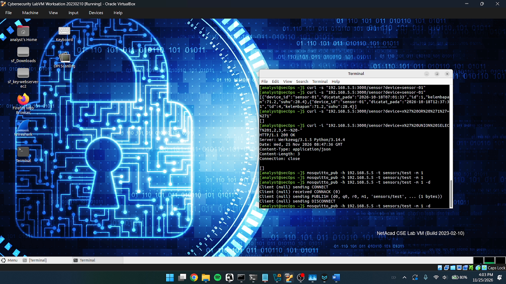

| Uji | Kondisi sebelum mitigasi | Kondisi sesudah mitigasi | Kesimpulan |
| --- | --- | --- | --- |
| Permintaan normal `sensor-01` | dua baris, repr tuple Python | dua baris, JSON terstruktur | aplikasi berfungsi, format lebih aman |
| Payload OR `x' OR '1'='1` | empat baris, seluruh isi tabel | array kosong | tertutup |
| Payload AND `x' AND '1'='2` | nol baris | nol baris | tidak lagi bermakna sebagai pembeda |
| Payload UNION empat kolom | galat 500 dengan jejak internal | HTTP 200 dengan badan kosong | tertutup, tanpa kebocoran galat |

Dari empat baris di atas, dua baris terakhir perlu penjelasan tambahan. Payload AND menghasilkan nol baris pada kedua kondisi, sehingga tidak bisa dipakai sebagai bukti perubahan. Ini bukan kelemahan pengujian, melainkan sifat payload itu sendiri: ia dirancang untuk membuktikan bahwa klausa tambahan dieksekusi, bukan untuk membaca data. Bukti perubahan yang sah ada pada payload OR.

### 6.3 Verifikasi MQTT

Bagian ini harus ditulis dengan sangat hati-hati, karena hasilnya tidak sesempurna dua bagian sebelumnya.

Setelah konfigurasi diubah, uji publish dijalankan dari mesin penyerang dan hasilnya `Error: Connection refused`. Pada saat itu kesimpulan sementara adalah broker berhenti. Kesimpulan itu gugur setelah diuji dari mesin target sendiri.

**Langkah 1: memastikan layanan hidup.** `systemctl is-active mosquitto` dijawab `active`. Layanan tidak berhenti, jadi pesan sebelumnya bukan tanda broker mati.

**Langkah 2: menguji publish dari mesin target.** Perintah `mosquitto_pub -h 192.168.5.5 -t sensors/test -m 1 -d` dijawab `Client null sending CONNECT` lalu `Client null received CONNACK (0)`. Kode 0 berarti koneksi diterima tanpa autentikasi. Ini bukan penolakan, melainkan kebalikannya: broker masih menerima klien anonim.

**Langkah 3: mencari sebabnya.** Pemeriksaan isi direktori konfigurasi menemukan tiga berkas: `README`, `default.conf` bertanggal 25 November yang memuat `allow_anonymous false` dan `password_file`, serta `pb15-awal.conf` bertanggal 18 Oktober yang masih memuat `allow_anonymous true`. Mosquitto memuat berkas pada direktori itu sesuai urutan abjad, dan nilai yang dibaca terakhir yang berlaku. `pb15-awal.conf` dibaca setelah `default.conf`, sehingga nilai lama menang.

**Langkah 4: berkas hak akses.** `ls -la /etc/mosquitto/passwd` menunjukkan berkas dimiliki `mosquitto:mosquitto` dengan mode `-rw-r-----` dan ukuran 121 byte. Artinya masalah izin yang sebelumnya menyebabkan `status=13` sudah beres, dan yang tersisa hanya konflik konfigurasi.

Kesimpulan yang bisa dibuat: **autentikasi MQTT belum berlaku, meski konfigurasinya sudah ditulis dengan benar.** Penyebabnya berkas lama yang menimpa, dan berkas itu belum dipindahkan pada saat laporan ini disusun. Klaim yang tidak bisa dibuat: bahwa broker sudah menolak klien anonim.

Perbaikannya satu langkah, yaitu memindahkan berkas lama keluar dari direktori konfigurasi lalu memulai ulang layanan. Sesudah itu uji yang sama harus menghasilkan kode 5, bukan 0. Bila hasilnya 5, barulah autentikasi bisa dinyatakan bekerja, dan pengujian dengan kredensial sah perlu dijalankan untuk memastikan jalur sensor tidak ikut putus.

Sikap ini dipilih meskipun kurang menguntungkan dari sisi penilaian. Menyatakan MQTT sudah tertutup akan membuat tabel verifikasi terlihat lengkap, tetapi klaim itu bertentangan dengan keluaran yang tercatat. Pada pekerjaan keamanan, klaim yang bertentangan dengan bukti lebih berbahaya daripada pengakuan adanya celah, karena membuat orang berhenti memeriksa.

### 6.4 Verifikasi pada lapisan jaringan

Bukti pendukung diambil dari tangkapan lalu lintas selama sesi verifikasi. Berkas tangkapan berisi 45 paket yang mencakup permintaan HTTP ke port 3000 dan percobaan koneksi ke port 1883.

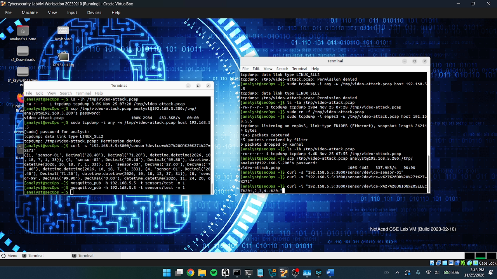

Tangkapan ini punya nilai tersendiri. Ia menunjukkan bahwa pengujian verifikasi benar-benar dijalankan di jaringan, bukan disusun dari catatan. Namun perlu dinyatakan bahwa isi tangkapan tidak dianalisis mendalam pada laporan ini, karena fokus verifikasi ada pada hasil di sisi aplikasi.

### 6.5 Rekap status verifikasi

| Skenario | Objek yang diuji | Status verifikasi | Dasar |
| --- | --- | --- | --- |
| 1 Pengintaian | jumlah port terbuka | terverifikasi | pemindaian ulang, tiga port terbuka pada scan 24 Nov, dua pada scan setelah hardening |
| 2 Kredensial | MySQL dan SSH | terverifikasi | hasil identik dengan sebelum mitigasi, kontrol sudah aktif |
| 3 SQL injection | endpoint `/sensor` | terverifikasi | payload identik, hasil berubah dari bocor menjadi kosong |
| 3 MQTT | broker 1883 | belum tuntas | broker masih menerima klien anonim, berkas konfigurasi lama belum dipindahkan |

Tiga dari empat objek terverifikasi penuh. Satu objek, yaitu MQTT, berstatus belum tuntas dan tidak boleh dibulatkan menjadi berhasil.

### 6.6 Yang tidak berubah dan mengapa itu wajar

Pada Skenario 1 dan 2, hasil sesudah mitigasi sama dengan hasil sebelum mitigasi. Ini bisa disalahartikan sebagai "mitigasi tidak berpengaruh", padahal artinya sebaliknya.

Pada Skenario 1, jumlah port terbuka tetap dua karena memang sudah dua sejak pengukuran awal. Yang berubah adalah konteksnya: angka itu sekarang menjadi dasar pernyataan bahwa permukaan serangan sudah minimal, bukan bahwa masih ada celah.

Pada Skenario 2, MySQL tetap timeout dan SSH tetap menolak, karena kontrolnya sudah aktif sejak Fase 1. Tidak ada perubahan karena tidak ada yang perlu diubah. Yang dilakukan pada tahap verifikasi adalah mengonfirmasi bahwa kontrol itu masih bekerja setelah seluruh perubahan lain dilakukan, yang bukan pekerjaan sia-sia: perubahan konfigurasi pada satu layanan sering merusak layanan lain tanpa disadari.

---

## 7. Post-Incident Activity dan Lessons Learned

### 7.1 Apa yang berjalan baik

**Pengukuran dilakukan pada kondisi yang sudah diperketat.** Keputusan ini mengubah seluruh bentuk laporan. Bila pengukuran dilakukan pada mesin mentah, hasilnya akan berupa daftar panjang keberhasilan serangan yang tidak informatif. Dengan mengukur pada kondisi yang sudah diperketat, hasilnya memisahkan dengan jelas antara kontrol yang bekerja dan celah yang benar-benar terbuka.

**Bukti before dan after diwajibkan sejak awal.** Aturan ini terasa merepotkan saat dijalankan, tetapi baru terasa nilainya ketika analisis disusun. Setiap pernyataan tentang kontrol yang bekerja punya rujukan berkas, sehingga tidak ada klaim yang bergantung pada ingatan.

**Pembanding positif dipakai pada setiap verifikasi.** Kebiasaan menjalankan permintaan normal sebelum menguji payload mencegah kesalahan paling umum dalam verifikasi keamanan, yaitu menyimpulkan "berhasil ditutup" padahal aplikasinya mati.

**Temuan yang gagal dicatat sebagai temuan.** Bagian 4.4.5 menyatakan bahwa insiden skenario ketiga tidak terdeteksi oleh sistem. Ini pernyataan yang tidak enak ditulis, tetapi justru merupakan analisis yang paling bernilai dalam laporan ini, karena menunjukkan di mana kemampuan pemantauan perlu ditingkatkan.

### 7.2 Apa yang tidak berjalan baik

**Berkas konfigurasi lama tidak pernah dibersihkan.** Ini penyebab kegagalan paling menyita waktu. Berkas `pb15-awal.conf` dari bulan Oktober tetap berada di direktori konfigurasi dan menimpa konfigurasi baru karena dimuat paling akhir. Waktu yang hilang untuk menemukannya lebih lama daripada waktu yang dipakai untuk menulis konfigurasi barunya sendiri. Pelajarannya: pada sistem yang memuat konfigurasi dari banyak berkas, yang harus diperiksa bukan berkas yang baru ditulis, melainkan nilai efektif yang benar-benar dipakai.

**Izin berkas kata sandi tidak diperhitungkan.** Broker berjalan sebagai pengguna `mosquitto`, sedangkan berkas kata sandi dibuat oleh root dengan mode 600. Kegagalan yang muncul hanya berupa kode keluar 13 tanpa penjelasan di layar, dan penyebabnya baru terlihat setelah membaca log. Pelajarannya: setiap layanan yang membaca berkas rahasia memerlukan pemeriksaan kepemilikan, bukan hanya pemeriksaan isi.

**Berkas perbaikan tidak pernah sampai ke target.** `app_fixed.py` disiapkan di mesin penyusun, tetapi folder bersama pada mesin virtual ternyata tidak terpasang, sehingga berkas itu tidak pernah ada di Target Node. Yang berjalan adalah versi lain yang diperbaiki langsung di mesin target. Akibatnya dokumentasi perubahan tidak sepenuhnya mencerminkan keadaan sebenarnya. Pelajarannya: kesiapan berkas harus diverifikasi di sisi tujuan, bukan diasumsikan dari sisi asal.

**Deteksi tidak dirancang untuk lapisan aplikasi.** Seluruh aturan deteksi yang terpasang berorientasi pada pola jaringan umum. Tidak ada aturan untuk pola SQL injection pada parameter URL, dan tidak ada aturan untuk penyisipan pesan MQTT. Sensor juga berjalan dalam mode import, sehingga kelengkapan bukti bergantung pada benar tidaknya berkas tangkapan diambil.

**Tidak ada mekanisme koreksi data.** Ketika data palsu harus dihapus, akun aplikasi ternyata tidak punya hak DELETE. Ini benar dari sisi pembatasan hak, tetapi menunjukkan tidak adanya prosedur resmi untuk mengoreksi data yang sudah terlanjur masuk secara tidak sah.

### 7.3 Kontrol yang masih perlu diperkuat

| Kontrol | Keadaan sekarang | Yang perlu dilakukan | Prioritas |
| --- | --- | --- | --- |
| Autentikasi MQTT | konfigurasi terpasang, status fungsional belum terbukti | uji dengan kredensial sah, pisahkan penolakan dari kegagalan layanan | tinggi |
| Daftar putih `device_id` | subscriber masih memakai nama topik apa adanya | batasi identitas perangkat yang boleh menulis | tinggi |
| Deteksi lapisan aplikasi | tidak ada aturan untuk SQL injection dan MQTT | tambahkan aturan pada sensor, uji dengan payload yang sudah tercatat | tinggi |
| Sensor pemantauan | mode import, bukan pemantauan langsung | jalankan sensor pada antarmuka jaringan secara langsung | sedang |
| Prosedur koreksi data | bergantung pada akun super | buat prosedur pembersihan yang tercatat dan terbatas | sedang |
| Alamat penyerang | hilang setiap reboot | perbaiki aturan netplan agar tahan pembaruan kernel | rendah |
| Pendaftaran layanan dashboard | dijalankan manual, tidak ada unit sistem | buat unit systemd agar kondisi layanan konsisten | rendah |

Empat baris pertama bersifat wajib sebelum sistem dinyatakan siap. Tiga baris terakhir bersifat operasional dan tidak memengaruhi keamanan secara langsung, tetapi memengaruhi keandalan pengujian berulang.

### 7.4 Pembelajaran tim

**Keamanan bukan daftar alat, melainkan cara membaca kondisi.** Alat yang dipakai di proyek ini semuanya standar: nmap, Hydra, curl, mosquitto, fail2ban, Security Onion. Yang membedakan hasil bukan alatnya, melainkan kemampuan menafsirkan keluarannya. Timeout pada MySQL dan penolakan pada SSH terlihat seperti kegagalan, padahal keduanya adalah bukti bahwa kontrol bekerja. Tanpa kemampuan membaca itu, tim akan menyimpulkan hal yang berlawanan dengan kenyataan.

**Kegagalan yang jujur lebih berharga daripada keberhasilan yang dibulatkan.** Dua hal dalam laporan ini tidak enak ditulis: insiden skenario ketiga tidak terdeteksi, dan verifikasi MQTT belum tuntas. Keduanya bisa saja dihilangkan agar laporan terlihat rapi, tetapi menghilangkannya berarti menutup justru bagian yang paling perlu diperbaiki. Sistem yang dinilai aman berdasarkan laporan yang tidak jujur akan gagal pada pengujian pertama di dunia nyata.

**Perbedaan antara "tidak bisa" dan "tidak mencoba" harus dibedakan.** Pada Skenario 2, Hydra melaporkan nol kata sandi valid. Angka itu mudah dibaca sebagai "kata sandi kuat". Padahal Hydra tidak pernah membentuk koneksi, sehingga tidak ada satu pun kata sandi yang diuji. Perbedaan ini menentukan rekomendasi: bila yang terjadi adalah kata sandi kuat, rekomendasinya adalah kebijakan kata sandi; bila yang terjadi adalah jalur tertutup, rekomendasinya adalah mempertahankan konfigurasi.

**Konfigurasi harus diperiksa pada nilai efektif, bukan pada berkas yang ditulis.** Kegagalan MQTT memberi pelajaran ini dengan cara yang mahal. Berkas konfigurasi baru sudah benar isinya, tetapi tetap tidak berlaku karena ada berkas lain yang menimpa. Pelajaran ini berlaku umum untuk sistem apa pun yang memuat konfigurasi berlapis.

**Reversibilitas harus direncanakan sejak awal.** Menyimpan versi sebelum perubahan terbukti penting bukan hanya untuk pemulihan, tetapi juga untuk kebutuhan demonstrasi. Tanpa versi tersimpan, satu-satunya cara memperlihatkan kondisi rentan adalah membangun ulang dari nol.

### 7.5 Rekomendasi lanjutan untuk sistem IoT asli

Bagian ini berada di luar lingkup penilaian PBL, tetapi disusun karena temuan pada replika punya padanan langsung pada produk asli.

**Pindahkan validasi dari aplikasi ke aturan akses basis data.** Pada replika, celah SQL injection bisa ditutup pada kode aplikasi. Pada produk asli yang memakai Firebase, padanannya adalah Security Rules. Aturan itu harus membatasi siapa yang boleh menulis ke path mana, dan menolak penulisan yang tidak sesuai skema. Selama aturan itu permisif, kode aplikasi sebagus apa pun tidak akan menolong.

**Berikan identitas pada setiap perangkat, jangan pada setiap sistem.** Pada replika, satu akun `iotuser` dipakai untuk seluruh koneksi. Bila konfigurasi ini diterapkan pada produk asli, satu perangkat yang kuncinya bocor berarti seluruh perangkat bisa dipalsukan. Yang seharusnya dipakai adalah kredensial per perangkat, sehingga perangkat yang dicurigai bisa dicabut aksesnya tanpa mengganggu yang lain. Ini setara dengan praktik sertifikat klien pada MQTT.

**Validasi di sisi penerima, bukan hanya di sisi pengirim.** Subscriber pada replika menerima `device_id` dari nama topik tanpa daftar putih. Pola ini berbahaya karena mengandalkan kepatuhan pengirim. Penerima harus memverifikasi bahwa identitas yang dikirim sesuai dengan kredensial yang dipakai. Prinsipnya sederhana: jangan percaya klaim identitas yang datang bersama data.

**Tetapkan rentang nilai yang wajar dan tolak yang di luar rentang.** Data palsu pada pengujian ini berisi suhu 99.90 derajat, yang secara fisik tidak mungkin pada peternakan sapi perah. Pemeriksaan sederhana terhadap rentang nilai akan menolaknya sebelum masuk basis data. Ini kontrol murah yang menutup seluruh kelas serangan penyisipan data, bukan hanya satu payload tertentu.

**Bangun jalur deteksi sejak awal, jangan setelah insiden.** Pada proyek ini, kemampuan deteksi baru dibangun ketika serangan sudah berjalan, dan hasilnya belum memadai untuk lapisan aplikasi. Untuk produk asli, log akses dan log perubahan data harus sudah mengalir ke satu tempat sejak hari pertama, dengan aturan yang mengenali pola penyalahgunaan.

**Buat prosedur pembersihan data yang terbatas dan tercatat.** Bila data palsu masuk ke sistem nyata, tim operasional harus bisa menghapusnya tanpa memakai akun super, dan setiap penghapusan harus tercatat. Tanpa prosedur ini, pilihan yang tersedia hanya dua, yaitu membiarkan data palsu atau memberi hak hapus yang terlalu luas kepada aplikasi.

**Pisahkan data operasional dari data uji.** Seluruh data pada replika bersifat dummy, sehingga dampak insiden terbatas. Pada sistem nyata, data suhu dan kelembapan menentukan kapan sprinkler menyala, sehingga berkaitan langsung dengan kesejahteraan ternak dan keputusan usaha. Pemisahan jalur, kredensial, dan basis data antara lingkungan uji dan produksi bukan formalitas, melainkan pengaman agar kesalahan pengujian tidak menjadi kerugian nyata.

### 7.6 Penutup

Insiden yang disimulasikan dalam proyek ini tidak spektakuler. Nilainya ada pada bentuknya yang biasa: satu parameter yang tidak divalidasi, satu broker yang menerima siapa saja, dan satu berkas konfigurasi lama yang tertinggal. Ketiganya bukan kesalahan yang rumit, dan justru karena itu ketiganya sering lolos dari perhatian.

Yang membuat insiden ini berbahaya bukan tingkat kerumitannya, melainkan sifatnya yang tidak terlihat. Dashboard tetap menampilkan angka, sistem tetap berjalan, dan tidak ada satu pun peringatan yang muncul. Kesalahan seperti ini hanya bisa ditemukan bila ada pihak yang secara sengaja mencoba mencari kesalahan, dan hanya bisa diperbaiki bila ada pihak yang bersedia mencatat apa yang tidak berjalan.

---

## 8. Lampiran

### 8.1 Struktur repositori

Seluruh berkas pendukung berada pada repositori GitHub kelompok dengan struktur sebagai berikut.

| Lokasi | Isi |
| --- | --- |
| `docs/design/` | topologi, rencana alamat, inventaris aset |
| `docs/reports/` | Security Baseline Document |
| `docs/presentation-minggu9/` | bahan Pertemuan 9, deklarasi tech stack |
| `docs/blueteam/` | hardening checklist sepuluh kontrol, bukti before dan after |
| `docs/redteam/` | attack plan, aturan keterlibatan, laporan red team fase 2 |
| `docs/redteam/evidence/` | dua puluh empat tangkapan layar, tersusun pada tiga skenario |
| `docs/final/` | incident report, sumber markdown, lampiran, bukti verifikasi |
| `docs/presentation-final/` | bahan presentasi akhir |
| `docs/purple-team-log.md` | catatan lima tahap untuk tiga skenario |
| `docs/logbook.md` | logbook proyek per pekan |

### 8.2 Daftar berkas per bagian laporan

| Bagian | Berkas rujukan |
| --- | --- |
| 2 Arsitektur | `docs/design/topology.png`, `docs/design/ip_plan.md`, `docs/design/asset-inventory.csv` |
| 3 Preparation | `docs/blueteam/hardening_checklist.md`, `docs/blueteam/evidence/before/`, `docs/blueteam/evidence/after/` |
| 4 Detection | `docs/redteam/evidence/skenario-1-recon/` sampai `skenario-3-web-mqtt/`, `docs/final/lampiran/` |
| 5 Containment | `docs/final/bukti-verifikasi/`, `docs/redteam/laporan-redteam-fase-2.docx` |
| 6 Verifikasi | `docs/final/bukti-verifikasi/` |
| 7 Lessons Learned | `docs/purple-team-log.md` |

### 8.3 Bukti red team per skenario

**Skenario 1, pengintaian.** SS-01 pemeriksaan alamat dan rute, SS-02 penemuan host, SS-03 identitas target, SS-04 pemindaian seluruh port, SS-05 detail layanan, SS-06 sidik sistem operasi, SS-07 penangkapan lalu lintas, SS-07b pencarian pada Kibana.

**Skenario 2, percobaan kredensial.** SS-08 enumerasi NSE pada MySQL, SS-09 uji koneksi 3306, SS-10 Hydra pada MySQL, SS-11 Hydra pada SSH, SS-11b konfigurasi efektif sshd, SS-12 status jail fail2ban, SS-12b catatan fail2ban.

**Skenario 3, web dan MQTT.** SS-13 keadaan normal, SS-14 payload OR, SS-15 payload UNION, SS-16 payload AND, SS-17 langganan MQTT, SS-18 pengiriman pesan palsu, SS-19 data palsu pada tabel, SS-19b log subscriber, SS-20 dashboard menampilkan data palsu.

### 8.4 Bukti verifikasi sesudah mitigasi

V1 pembanding normal dan payload OR, V2 payload UNION dengan HTTP 200, V4 tangkapan lalu lintas sesi verifikasi.

### 8.5 Bukti hardening

Enam belas berkas keadaan sebelum dan empat belas berkas keadaan sesudah, tersimpan pada `docs/blueteam/evidence/before/` dan `docs/blueteam/evidence/after/`. Daftar lengkapnya ada pada `docs/blueteam/evidence/README.md`.

### 8.6 Video demonstrasi

Rekaman demonstrasi tidak disimpan di repositori karena ukurannya, dan tautannya dicantumkan pada README. Isi yang wajib tampak pada rekaman: penyerangan pada kondisi rentan, pengamatan lalu lintas, penerapan mitigasi, dan pengulangan payload yang sama pada kondisi sesudah mitigasi, dengan nama host dan alamat IP terlihat sepanjang rekaman.

### 8.7 Catatan tentang kode bukti

Kode SS-01 sampai SS-20 pada laporan ini merujuk pada tangkapan layar yang sama dengan yang dipakai pada laporan red team fase 2. Penomoran dipertahankan agar pembaca bisa membandingkan kedua dokumen tanpa kebingungan. Dua kode yang tidak berurutan, yaitu SS-07b dan SS-11b, adalah bukti tambahan yang diambil setelah penomoran awal selesai, dan sengaja diberi akhiran agar tidak menggeser nomor yang sudah dirujuk di tempat lain.

### 8.8 Pemeriksaan kelengkapan artefak Minggu 1 sampai 13

Lampiran ini memeriksa apakah seluruh artefak yang dihasilkan sepanjang proyek lengkap dan saling sesuai. Pemeriksaan dilakukan dengan membandingkan angka, tanggal, dan nama berkas pada setiap dokumen terhadap bukti mentah yang tersimpan.

| Artefak | Berkas | Minggu | Status | Dasar pemeriksaan |
| --- | --- | --- | --- | --- |
| Topologi | `docs/design/topology.png`, `topologi.jpeg` | 1-3 | lengkap | tiga node, segmen 192.168.5.0/24, sesuai ip plan |
| Rencana alamat | `docs/design/ip_plan.md` | 1-3 | lengkap | tiga alamat tetap, tanpa gateway, sesuai topologi |
| Inventaris aset | `docs/design/asset-inventory.csv` | 4 | lengkap | tujuh aset, port terbuka sama dengan hasil pemindaian |
| Deklarasi tech stack | `docs/presentation-minggu9/tech_stack_declaration.md` | 9 | lengkap | pemetaan Firebase ke Mosquitto dan MySQL |
| Baseline keamanan | `docs/reports/security-baseline-document.pdf` | 7 | lengkap | keadaan normal sebelum hardening |
| Hardening checklist | `docs/blueteam/hardening_checklist.md` | 9 | lengkap | sepuluh kontrol, setiap kontrol punya bukti before dan after |
| Bukti hardening | `docs/blueteam/evidence/before/`, `after/` | 9 | lengkap | 16 berkas sebelum, 14 berkas sesudah |
| Bukti verifikasi | `docs/final/bukti-verifikasi/` | 13 | lengkap | tiga berkas sesudah mitigasi |
| Attack plan | `docs/redteam/attack_plan.md` | 9 | lengkap | tiga skenario, tiga kategori berbeda, tanpa DoS |
| Aturan keterlibatan | `docs/rules-of-engagement.md` | 9 | lengkap | batas lingkup dan larangan menyentuh sistem mitra |
| Bukti red team | `docs/redteam/evidence/` | 10-11 | lengkap | 24 berkas, tersusun pada tiga folder skenario |
| Laporan red team fase 2 | `docs/redteam/laporan-redteam-fase-2.docx` | 11 | lengkap | 11 bab, 24 gambar, 31 tabel |
| Purple team log | `docs/purple-team-log.md` | 10-11 | lengkap | 15 sel terisi, tiga skenario lima tahap |
| Incident report | `docs/final/incident_report.pdf` | 13 | lengkap | delapan bagian NIST SP 800-61r2 |
| Video demonstrasi | tautan pada README | 12-13 | belum ada | rekaman belum dibuat, tautan menyusul |
| Bahan presentasi | `docs/presentation-final/slides-final.pdf` | 14 | lengkap | 13 slide, tujuh bagian wajib |

Empat ketidaksesuaian ditemukan pada pemeriksaan ini dan sudah diperbaiki sebelum laporan dirender. Semuanya bersumber pada angka yang ditulis dari ingatan, bukan dari berkas bukti.

| Temuan | Keadaan sebelumnya | Keadaan yang benar | Perbaikan |
| --- | --- | --- | --- |
| Jumlah port terbuka | tertulis dua port | tiga port, yaitu 22, 1883, dan 3000, dengan 65532 tersaring | diubah pada log, laporan, dan slide |
| Bentuk kegagalan MySQL | tertulis Connection refused | Connection timed out, karena paket dijatuhkan sebelum sampai | diubah pada checklist C1 dan ringkasan |
| Status MQTT | tertulis Connection refused, seolah broker mati | CONNACK 0, broker hidup dan masih menerima klien anonim | bagian 6.3 ditulis ulang dengan urutan pengujian |
| Paparan dashboard | tertulis sudah terikat ke loopback | belum, port 3000 masih dilayani ke segmen penyerang | diubah pada bagian 5.3.3 dan tabel pemetaan |

Satu ketidaksesuaian lain bersifat teknis dan tidak mengubah isi laporan, tetapi membuat gambar tidak tampil: berkas `docs/design/topology.png` hanya berisi dua byte. Berkas itu dihasilkan ulang dari `topologi.jpeg` pada resolusi dua kali lipat.

Perbedaan angka pemindaian antara 19 Oktober dan 24 November bukan ketidaksesuaian, melainkan dua pengukuran pada waktu berbeda. Keduanya dicatat pada Bagian 2.3 dengan penjelasan sebabnya, agar pembaca yang membuka dua berkas bukti tidak menyimpulkan adanya pertentangan.
